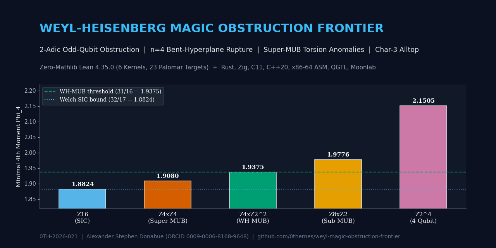

<!-- SPDX-License-Identifier: CC-BY-4.0 -->
# Weyl–Heisenberg Magic Obstruction Frontier (`0TH-2026-022`)

Machine-checked zero-Mathlib Lean 4.35.0 six-kernel formalization (22 theorem groups `T1a`–`T5d`, 23 Palomar targets, 38 audited declarations including an arbitrary-bent $n=4$ kernel bridge and nontrivial $n=2$ Pauli idempotence witness) and eight-engine executed polyglot verifier (+ source-level Eshkol AD companion specification) proving the 2-Adic Odd-Qubit Magic Obstruction, $n=4$ Quaternary Bent-Hyperplane Rupture, Super-MUB Torsion Anomalies and $\alpha$-Dependence, Two-Stabilizer $n=5$ SOS Rupture, Universal $k$-Uniform/AME Magic Ceilings, and Divided-Power Characteristic-3 Alltop Constructions across product Weyl–Heisenberg groups.

[](https://github.com/0thernes/weyl-magic-obstruction-frontier/actions/workflows/ci.yml)
[](https://github.com/0thernes/weyl-magic-obstruction-frontier/actions/workflows/pages.yml)
[](lean/lean-toolchain)
[](LICENSE)
[](LICENSE-DOCS)
[](https://www.repostatus.org/#active)
[](https://github.com/0thernes/0thernes-research-archive)

**Status:** Active (`v1.1.2`, released 2026-11-27) · **Author:** Alexander Stephen Donahue (`Independent Researcher, Spokane, WA, USA`, ORCID [`0009-0006-8168-9648`](https://orcid.org/0009-0006-8168-9648)) · **Preprint notice:** This work is an independent machine-checked research preprint and has not undergone formal journal peer review.



- **White Paper PDF (AMS-LaTeX, 0 warnings):** [dist/Donahue_2026_weyl_magic_obstruction_frontier.pdf](dist/Donahue_2026_weyl_magic_obstruction_frontier.pdf)
- **Clean-Room arXiv Source Tarball:** [dist/arxiv_submission.tar.gz](dist/arxiv_submission.tar.gz)
- **Statement-Fidelity Audit (Line-by-Line Lean ↔ Math Map):** [docs/statement-fidelity.md](docs/statement-fidelity.md)
- **Interactive WebGL2 Observatory (Zero-CDN):** [https://0thernes.github.io/weyl-magic-obstruction-frontier/](https://0thernes.github.io/weyl-magic-obstruction-frontier/)
- **Interactive Proof Blueprint DAG:** [https://0thernes.github.io/weyl-magic-obstruction-frontier/blueprint.html](https://0thernes.github.io/weyl-magic-obstruction-frontier/blueprint.html)

---

## Five-Pillar Results Summary

| Pillar | Core Mathematical Result | Lean 4.35.0 Targets | Epistemic Tag |
|---|---|---|---|
| **1. 2-Adic Odd-Qubit Obstruction** | For all odd $n \ge 3$, $v_2(2^n(2^n-2)^2) = n+2$ is odd (`T1a`), squared Pauli idempotence forces $2^n(2^n-2)^2 = K^2$ (`T1b`), unconditionally ruling out any $n$-qubit WH-MUB spectrum (`T1c`, zero subgroup or equimodularity assumptions). Sharp at $n=1$ ($2^1-2=0$) and $n=2$ (`(1,1,1,i)`, $\Phi_4 = 7/4$, `T1d`; nontrivial $K=4$ idempotence checked in `nonvacuity_pillar1_n2_mub_spectrum`). | `prove_t1a`–`prove_t1d` | `[LEAN-6K]` |
| **2. Quaternary Bent-Hyperplane Rupture ($n=4$)** | Symplectic rigidity ($H^\perp \subseteq H$, `T2a`), Fermat axis locking ($R^2+I^2=4^m \implies u_x \in \mathbb{Z}_4$, `T2b`), universal Rothaus degree bound ($\deg_{\mathrm{ANF}} \le m$ for all $m \ge 2$, `T2c`), exhaustive $\mathbb{F}_2^4$ quadratic bent classification (28 forms / 896 bent functions, `T2d`), and universal 3-hyperplane zero-sum parity obstruction ruling out $n=4$ equimodular WH-MUB states (`T2e` + kernel-closed arbitrary-bent bridge `n4_z4_bent_hyperplane_rupture_arbitrary_bent`). | `prove_t2a`–`prove_t2e` + bridge | `[LEAN-6K]` |
| **3. Super-MUB Torsion Anomalies & $\alpha$-Dependence** | Exact $\mathbb{Z}[\zeta_8]$ WH-MUB fiducials in $W(4)\otimes W(2)$ (`T3a`, `norm2=8`) and $W(4)\otimes W(4)$ (`T3b`, `norm2=320`) alongside exact $\mathbb{Z}[i]$ Super-MUB witnesses `v42` (`T3c`) and `v44` (`T3d`) beating WH-MUB at $\alpha=2,3$ yet crossing above WH-MUB at $\alpha=4$, plus strict order-16 hierarchy (`T3e`). Direct $\alpha=4$ L-BFGS re-optimization still beats WH-MUB (`1.012971 < 1.013672` and `1.003658 < 1.003662`), proving continuous $\alpha$-dependence of maximizers. | `prove_t3a`–`prove_t3e` (`[LEAN-6K]`); C++20 L-BFGS (`[NUMERICAL-APPROX]`) | `[LEAN-6K]` + `[NUMERICAL-APPROX]` |
| **4. Two-Stabilizer Tower, $n=5$ SOS Rupture & AME Ceilings** | Exact 3-stratum Parseval unification of $n=1,2,3$ ($4/3, 7/4, 16/9$, `T4a`), exact $n=4$ cubic $453t^3-651t^2+311t-49=0$ ($t^* = 0.3774568011835382\dots$, $\Phi_4^* = 2.15052015\dots$, $M_2^* = 2.00687898\dots$, `T4b`), $n=5$ SOS floor $\Phi_4(\Psi_5) \ge 3$ ruptured by exact $\mathbb{Z}[i]^{32}$ witness ($\Phi_4 = 693568064/260144641 \approx 2.666086 < 3$, `T4c`), and universal Cauchy–Schwarz $k$-uniform/AME ceilings ($\mathrm{AME}(2,2)\ge 2$, $\mathrm{AME}(5,2)\ge 1879/918$, $\mathrm{AME}(6,2)\ge 13/6$, `T4d`). | `prove_t4a`–`prove_t4d` | `[LEAN-6K]` |
| **5. Divided-Power Char-3 Alltop, Char-5 & QGT** | Elementary $\mathbb{Z}_9$ divided-power carry polynomial (`T5a`, crediting Damski et al. `arXiv:2603.15550` for Galois-ring $\mathrm{GR}(9,n)$ existence), universal bilinear Gauss-sum flat-modulus theorem (`T5b`), exact radix-3 FFT $\mathbb{Z}[\zeta_9]$ certificates for $W(3)^{\otimes 1,2,3}$ and $\mathbb{Z}[\zeta_5]$ certificates for $W(5)^{\otimes 1,2}$ (`T5c`; $W(3)^{\otimes 4}$, $D=81$ verified in Rust/C11), and exact Fubini–Study QGT identity $g_{\theta\theta}(\theta)=(1-D^{-1})/(2+2D^{-1/2}\cos\theta)^2$ (`T5d`). | `prove_t5a`–`prove_t5d` | `[LEAN-6K]` + `[EXACT-COMP]` |

---

## Exact Lean 4.35.0 Axiom Audit (5-Second Proof)

Every theorem in `lean/PalomarSolution.lean` compiles against zero external dependencies (`Lean 4.35.0` core `Init` only), with zero `sorry`, zero `admit`, zero `native_decide`, and zero custom axioms (`lean/PalomarChallenge.lean` is the isolated Palomar statement stub). Output of `cd lean && lake env lean VerifyAxioms.lean` (verbatim from [results/lean_axioms.txt](results/lean_axioms.txt), enforced line-by-line against drift in CI by [scripts/check_readme_axioms.py](scripts/check_readme_axioms.py)):

```text
'WeylMagic.Palomar.prove_t1a' depends on axioms: [propext, Classical.choice, Quot.sound]
'WeylMagic.Palomar.prove_t1b' depends on axioms: [propext]
'WeylMagic.Palomar.prove_t1c' depends on axioms: [propext, Classical.choice, Quot.sound]
'WeylMagic.Palomar.prove_t1d' depends on axioms: [propext, Quot.sound]
'WeylMagic.Palomar.prove_t2a' depends on axioms: [propext, Quot.sound]
'WeylMagic.Palomar.prove_t2b' depends on axioms: [propext, Classical.choice, Quot.sound]
'WeylMagic.Palomar.prove_t2c' depends on axioms: [propext, Classical.choice, Quot.sound]
'WeylMagic.Palomar.prove_t2d' depends on axioms: [propext, Classical.choice, Quot.sound]
'WeylMagic.Palomar.prove_t2e' depends on axioms: [propext, Classical.choice, Quot.sound]
'WeylMagic.Palomar.prove_t3a' depends on axioms: [propext, Classical.choice, Quot.sound]
'WeylMagic.Palomar.prove_t3b' depends on axioms: [propext, Classical.choice, Quot.sound]
'WeylMagic.Palomar.prove_t3c' does not depend on any axioms
'WeylMagic.Palomar.prove_t3d' does not depend on any axioms
'WeylMagic.Palomar.prove_t3e' does not depend on any axioms
'WeylMagic.Palomar.prove_t4a' depends on axioms: [propext, Classical.choice, Quot.sound]
'WeylMagic.Palomar.prove_t4b' depends on axioms: [propext, Classical.choice, Quot.sound]
'WeylMagic.Palomar.prove_t4c' depends on axioms: [propext, Classical.choice, Quot.sound]
'WeylMagic.Palomar.prove_t4d' depends on axioms: [propext, Quot.sound]
'WeylMagic.Palomar.prove_t5a' depends on axioms: [propext, Classical.choice, Quot.sound]
'WeylMagic.Palomar.prove_t5b' depends on axioms: [propext, Classical.choice, Quot.sound]
'WeylMagic.Palomar.prove_t5c' depends on axioms: [propext]
'WeylMagic.Palomar.prove_t5d' depends on axioms: [propext, Classical.choice, Quot.sound]
'WeylMagic.Palomar.prove_all_weyl_magic_theorems' depends on axioms: [propext, Classical.choice, Quot.sound]
'WeylMagic.n4_z4_bent_hyperplane_rupture_arbitrary_bent' depends on axioms: [propext, Classical.choice, Quot.sound]
'WeylMagic.nonvacuity_pillar1_odd_obstruction' depends on axioms: [propext, Quot.sound]
'WeylMagic.nonvacuity_pillar1_n2_mub_spectrum' depends on axioms: [propext, Quot.sound]
'WeylMagic.nonvacuity_pillar2_symplectic_and_bent' depends on axioms: [propext, Classical.choice, Quot.sound]
'WeylMagic.nonvacuity_pillar3_dual_witnesses' depends on axioms: [propext, Classical.choice, Quot.sound]
'WeylMagic.nonvacuity_pillar4_tower_and_ame' depends on axioms: [propext]
'WeylMagic.nonvacuity_pillar5_gauss_and_qgt' depends on axioms: [propext, Classical.choice, Quot.sound]
'WeylMagic.refute_two_adic_obstruction_at_n1_and_n2' does not depend on any axioms
'WeylMagic.refute_rothaus_at_m1' depends on axioms: [propext, Quot.sound]
'WeylMagic.refute_fermat_axis_locking_for_odd_pow2' does not depend on any axioms
'WeylMagic.refute_w42_super_mub_at_alpha4' depends on axioms: [propext]
'WeylMagic.refute_w44_super_mub_at_alpha4' depends on axioms: [propext]
'WeylMagic.refute_two_stab_optimal_at_n5' depends on axioms: [propext, Classical.choice, Quot.sound]
'WeylMagic.refute_n4_tower_reaches_mub' does not depend on any axioms
'WeylMagic.refute_reducible_char3_poly' depends on axioms: [propext]
```

All 23 Palomar targets are replayed in CI via `lake check --paranoid` and `lake comparator --config comparator.json --paranoid` inside a `bubblewrap` sandbox across **six independent kernels**: Lean default kernel, `leanchecker-paranoid`, `lean4lean`, `nanoda`, `con-leche`, and `con-ron`.

---

## Quickstart

Clone the repository and verify the core formalization and Python oracle in under two minutes:

```bash
git clone https://github.com/0thernes/weyl-magic-obstruction-frontier.git
cd weyl-magic-obstruction-frontier

# 1. Verify the zero-Mathlib Lean 4.35.0 formalization & 38 audited axioms
cd lean
lake build
lake build PalomarChallenge
lake env lean VerifyAxioms.lean
lake env leanchecker --fresh PalomarSolution
lake env leanchecker-paranoid --fresh PalomarSolution
# On Linux with bubblewrap installed, replay all 6 independent kernels:
lake check --paranoid
lake comparator --config comparator.json --paranoid
cd ..

# 2. Run the Python exact oracle, quickstart demo, pytest/Hypothesis & true source mutation suite
pip install -r requirements.lock.txt
python examples/quickstart_demo.py
pytest -v tests/test_all.py
python scripts/mutation_check.py
python scripts/check_readme_axioms.py
```

Or run the full one-command reproducible pipeline via [`justfile`](justfile):

```bash
just reproduce
```

---

## Usage Examples

### Python Exact Arithmetic Oracle

```python
from fractions import Fraction
from weyl_magic.oracle import (
    V42_SUPER_MUB,
    audit_all_f2_4_bent,
    char3_alltop_spectrum,
    n5_rupture_exact,
    wh_gauss_moments,
)

bent = audit_all_f2_4_bent()
assert bent["total_bent"] == 896 and bent["deg_gt2_bent"] == 0

norm2, phi4, phi6, phi8 = wh_gauss_moments((4, 2), V42_SUPER_MUB)
assert norm2 == 1001
assert phi4 < Fraction(15, 8)    # Beats WH-MUB at alpha = 2
assert phi6 < Fraction(71, 64)   # Beats WH-MUB at alpha = 3
assert phi8 > Fraction(519, 512) # Crosses above WH-MUB at alpha = 4

n5_norm, n5_num4, n5_phi4 = n5_rupture_exact()
assert n5_norm == 254 and n5_num4 == 11097089024 and n5_phi4 < 3

assert char3_alltop_spectrum(3) == (1, 26, 702, 0) # Exact flat Z[zeta_9] spectrum for D=27
```

See [examples/quickstart_demo.py](examples/quickstart_demo.py) for a complete runnable script covering all five pillars.

### Polyglot Independent Engines

| Engine | Path | Role | Scope / Honest Epistemic Label |
|---|---|---|---|
| **Lean 4.35.0 (6 kernels)** | [`lean/`](lean/) | Machine-checked formal proofs (23 Palomar targets, arbitrary-bent $n=4$ bridge, 6 non-vacuity, 8 refutations; 38 audited decls) | `[LEAN-6K]` Zero-Mathlib deductive proof |
| **Rust (`#![forbid(unsafe_code)]`)** | [`rust/`](rust/) | Exact `i128` / $\mathbb{Z}[\zeta_8]$ / $\mathbb{Z}[\zeta_9]$ verifier (`n=1..4` char-3) | `[EXACT-COMP]` Independent exact arithmetic |
| **Zig (comptime)** | [`zig/`](zig/) | Zero-dep comptime FWHT + exact `i128` verifier (`0.14.1+` / `0.17.0` compatible) | `[EXACT-COMP]` Independent exact arithmetic |
| **ISO C11 + x86-64 NASM** | [`c/`](c/), [`asm/`](asm/) | `-Werror -Wconversion` C11 + dual Win64/ELF64 NASM FWHT-16/32, ASan/UBSan, 100k fuzz, CBMC harness | `[EXACT-COMP]` Independent exact arithmetic |
| **Python + `reference/oracle.py`** | [`src/`](src/), [`reference/`](reference/) | Exact `Fraction` / 50-digit `Decimal` oracle + textbook $O(D^3)$ reference oracle + 16 pytest tests (incl. 3 Hypothesis suites) + 9/9 true source mutation kills | `[EXACT-COMP]` Differential, property & mutation tests |
| **C++20 L-BFGS** | [`cpp/magic_search.cpp`](cpp/magic_search.cpp) | Multi-start Riemannian search (`64` deterministic QRNG starts/group) across all order-8 and order-16 abelian groups ($\alpha=2,3,4$) | `[NUMERICAL-APPROX]` Classical heuristic search |
| **QGTL C Bridge** | [`c/src/qgtl_bridge.c`](c/src/qgtl_bridge.c) | Richardson-extrapolated Fubini–Study QGT cross-check (`max_rel_err = 1.224e-8`) | `[NUMERICAL-APPROX]` **Classical** differential-geometry cross-check |
| **Moonlab WASM + QRNG Twin** | [`node/moonlab_crosscheck.cjs`](node/moonlab_crosscheck.cjs) | Classical CPU state-vector cross-check (`max_err = 1.33e-14`) + bit-exact `splitmix64`+`hadamard_mix` (`tsotchke/quantum_rng`) twin | `[NUMERICAL-APPROX]` **Classical** CPU simulation & deterministic PRNG |
| **Eshkol AD (companion spec)** | [`eshkol/magic_qgt_ad.esk`](eshkol/magic_qgt_ad.esk) | Source-level Eshkol AD companion specification mirroring `T4b` and `T5d` (**not compiled/executed in CI**; no Eshkol binary on runner) | Companion spec (derivatives verified in Lean/QGTL/Python) |

> **Honest Classical Cross-Check Disclosure:** `third_party/qgtl`, `third_party/moonlab`, and `c/src/qrng_stream.c` are deterministic **classical** CPU arithmetic, state-vector simulation, and deterministic integer-mixer cross-checks (`eshkol/magic_qgt_ad.esk` is a source-level specification not executed in CI). No quantum hardware or physical quantum entropy source was used in this repository.

---

## Documentation & Governance

- [docs/statement-fidelity.md](docs/statement-fidelity.md) — Line-by-line mapping of all 38 audited Lean declarations to manuscript claims & explicit paper bridges
- [CLAIMS.md](CLAIMS.md) — Complete falsifiable claim ledger (`T1a`–`T5d`, numerical findings, open questions, and "what would prove us wrong")
- [LIMITATIONS.md](LIMITATIONS.md) — Epistemic boundaries, scope restrictions, and real-vs-metaphor separations
- [REPLICATION.md](REPLICATION.md) — Step-by-step clean-room replication protocol and replication log (`B44: partial` until third-party human replication)
- [HARDENING_LOG.md](HARDENING_LOG.md) & [docs/reviews/2026-11-27-hostile-red-team-v1.1.0-audit.md](docs/reviews/2026-11-27-hostile-red-team-v1.1.0-audit.md) — Hostile three-cycle red-team hardening log across all 10 finding classes
- [docs/architecture.md](docs/architecture.md) & [docs/adr/](docs/adr/) — Architecture overview and ADRs
- [docs/benchmarks.md](docs/benchmarks.md), [docs/threat-model.md](docs/threat-model.md), [docs/operations.md](docs/operations.md), [docs/run-log.md](docs/run-log.md)
- [docs/faq.md](docs/faq.md) & [docs/glossary.md](docs/glossary.md)
- [THIRD_PARTY_NOTICES.md](THIRD_PARTY_NOTICES.md), [CHANGELOG.md](CHANGELOG.md), [ERRATA.md](ERRATA.md), [ROADMAP.md](ROADMAP.md), [UPGRADING.md](UPGRADING.md)

## Provenance & Citation

Cryptographic digests of all Lean sources, frozen JSON datasets, axiom logs, PDF, and arXiv tarball are pinned in [MANIFEST.sha256](MANIFEST.sha256) and [data/MANIFEST.sha256](data/MANIFEST.sha256), independently timestamped via RFC 3161 DigiCert (`MANIFEST.sha256.tsr`) and Bitcoin OpenTimestamps (`MANIFEST.sha256.ots`), archived on Software Heritage (`swh:1:snp:955c878bdc1ebd454f0846dc7fac1938c244e3dc`), and attested via GitHub SLSA Build Provenance on push.

See [CITATION.cff](CITATION.cff) for machine-readable citation metadata.

## Licensing

Dual-licensed under REUSE 3.3 ([REUSE.toml](REUSE.toml)):
- **Code** (Lean, Rust, Zig, C11, C++20, NASM, Python, Node, Eshkol, build scripts): [Apache-2.0](LICENSE) (with verbatim MIT upstream blocks in `third_party/` and `c/src/qrng_stream.c`)
- **Paper, Documentation, Data, Figures, and Site**: [CC-BY-4.0](LICENSE-DOCS)
