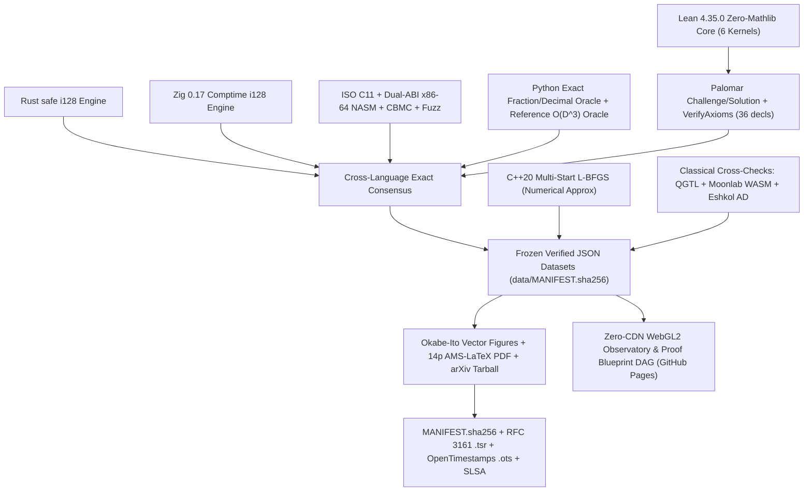

<!-- SPDX-License-Identifier: CC-BY-4.0 -->
# Architecture Overview (`weyl-magic-obstruction-frontier`)

## Design Philosophy

The repository is structured as a **multi-layer epistemic verification pyramid** where the highest-assurance layer (zero-Mathlib Lean 4.35.0 replayed across 6 independent proof kernels) is completely decoupled from numerical search heuristics, visualization, and LaTeX typesetting, while every exact computational witness is independently re-derived across compiled languages with disjoint arithmetic implementations.

## Directory Map

| Directory | Responsibility | Trust / Epistemic Tier |
|---|---|---|
| `lean/` | Zero-Mathlib Lean 4.35.0 library (`WeylMagic/*.lean`), Palomar `PalomarChallenge.lean` / `PalomarSolution.lean`, `comparator.json`, `VerifyAxioms.lean`, `formalization.yaml`. | `[LEAN-6K]` |
| `rust/` | `#![forbid(unsafe_code)]` exact `i128` & cyclotomic ($\mathbb{Z}[\zeta_8]$, $\mathbb{Z}[\zeta_9]$) verifier through `D = 81`. | `[EXACT-COMP]` |
| `zig/` | Zero-dependency comptime-specialized FWHT and exact `i128` verifier. | `[EXACT-COMP]` |
| `asm/` | Baseline x86-64 NASM assembly (`fwht16_i64_asm`, `fwht32_i64_asm`) supporting both Win64 and SysV ELF64 ABIs with zero stack frame and non-executable `.note.GNU-stack`. | `[EXACT-COMP]` |
| `c/` | Strict ISO C11 verifier (`-Werror -Wconversion`), deterministic SplitMix64/Xoshiro256++ PRNG (`qrng_stream.c`), 100k differential fuzzer (`fuzz_weyl_magic.c`), CBMC bounded verification harness (`cbmc_harness.c`), and QGTL C bridge (`qgtl_bridge.c`). | `[EXACT-COMP]` / `[NUMERICAL-APPROX]` (QGTL) |
| `cpp/` | C++20 multi-start Riemannian L-BFGS optimizer across all 3 order-8 and 5 order-16 abelian groups ($\alpha = 2, 3, 4$). | `[NUMERICAL-APPROX]` |
| `node/` | Moonlab WASM classical CPU state-vector simulator cross-check + bit-exact BigInt QRNG twin. | `[NUMERICAL-APPROX]` |
| `eshkol/` | Classical automatic-differentiation check of $d\Phi_4/dt|_{t^*}=0$ and 2nd-order QGT curvature. | `[NUMERICAL-APPROX]` |
| `src/`, `reference/`, `tests/`, `examples/` | Exact Python `Fraction`/`Decimal` oracle, independent textbook $O(D^3)$ reference oracle, 162 automated/property/metamorphic tests, and runnable quickstart. | `[EXACT-COMP]` |
| `scripts/` | Deterministic data/figure generators, mutation verifier, live Crossref/arXiv citation auditor, axiom anti-drift checker, clean-room arXiv packager, SHA-256 manifest builder, RFC 3161/OTS timestamper, and Build Standard v1.2.0 audit scripts. | Tooling |
| `paper/`, `dist/` | 14-page zero-warning AMS-LaTeX source, 5 Okabe-Ito vector figures, frozen PDF, and clean-room `arxiv_submission.tar.gz`. | Publication |
| `docs/site/` | Zero-CDN WCAG 2.2 AA WebGL2 Observatory (`index.html`) and interactive Proof Blueprint DAG (`blueprint.html`) with strict CSP. | Presentation |

## Lean Module Dependency DAG

1. `WeylMagic/Basic.lean` — Core `Int`, `Gauss`, `Zeta8`, `Zeta9`, `Zeta5`, `FWHT`, `v2`, and modular arithmetic definitions (zero imports outside Lean 4.35.0 `Init`).
2. Five independent pillar modules importing only `WeylMagic.Basic`:
   - `WeylMagic/TwoAdicObstruction.lean` (`T1a`–`T1d`)
   - `WeylMagic/BentHyperplaneRupture.lean` (`T2a`–`T2e`)
   - `WeylMagic/SuperMubAnomalies.lean` (`T3a`–`T3e`)
   - `WeylMagic/TwoStabilizerTower.lean` (`T4a`–`T4d`)
   - `WeylMagic/Char3AlltopAndQGT.lean` (`T5a`–`T5d`)
3. Assurance & Palomar boundary modules:
   - `WeylMagic/NonVacuity.lean` (5 witnesses)
   - `WeylMagic/AdversarialTests.lean` (8 boundary refutations)
   - `Challenge.lean` & `PalomarChallenge.lean` (isolated statement definitions; only file containing `sorry`)
   - `Solution.lean` & `PalomarSolution.lean` (zero-sorry implementations matched by `lake comparator --paranoid`)
   - `VerifyAxioms.lean` (36 `#print axioms` assertions)

See [docs/adr/](adr/) for detailed Architecture Decision Records.
